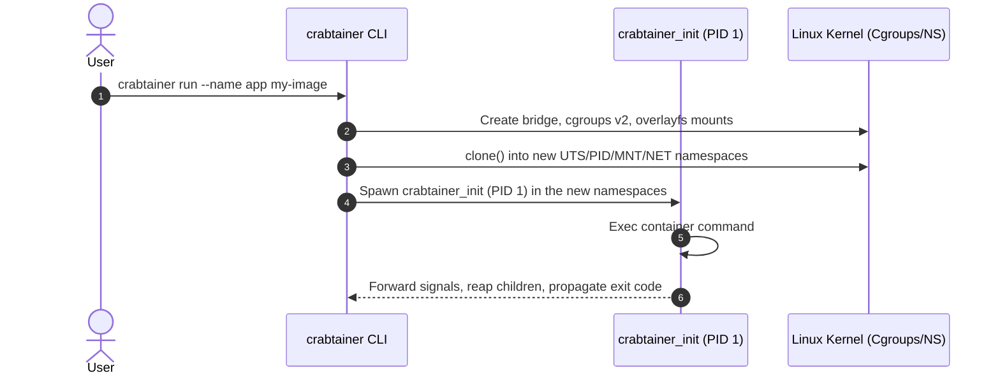

# Architecture Overview

Crabtainer follows a **daemonless model** inspired by Podman. There is no
background service: every operation is performed by a short-lived CLI process
that talks directly to the Linux kernel (namespaces, cgroups, networks) and
leaves its state on disk as plain files that later invocations re-read.

## Running a container

## Key Architectural Concepts

1. **No Background Daemon:** Eliminates the single point of failure and the
   continuous background resource overhead. State and "daemon" logic live in
   `containers/<id>/config.json` plus a few runtime artifacts; commands like
   `ps` rebuild their view from those files each time they run.

2. **`crabtainer_init` (PID 1):** A dedicated, minimal Rust binary
   (`crabtainer_init`) is bind-mounted read-only into the container as
   `/dev/.crabtainer_init`. It is the first process in the container (PID 1)
   and is responsible for forking the containerized command, forwarding
   `SIGINT`/`SIGTERM`, reaping zombie children, and propagating the exit code
   back to the CLI. This keeps a full init system out of the container while
   still behaving like a well-behaved PID 1.

3. **Storage & Isolation:** Uses Linux **OverlayFS** for layer composition —
   a layout's rootfs is the read-only lower layer, and each container adds its
   own `upper/` (+`work/`) layer so writes never touch the shared layout.
   Isolation comes from kernel **namespaces** (UTS, PID, mount, network) and
   per-container **cgroups v2** resource limits.

4. **Filesystem as state:** Every container directory under
   `containers/<id>/` fully describes the container. After a host reboot, a
   `refresh` pass compares the stored `boot_id` against the current one and
   reaps any "Active" container whose PID no longer belongs to this boot —
   this is how the daemonless model stays consistent across reboots.

## Container lifecycle (runtime path)

The container runtime performs the following steps:

1. **Validate & configure** — check the layout exists and gather options
   (name, limits, ports, env, volumes, restart policy).
2. **Networking setup** — ensure the `crabtainer0` bridge and IPAM pool are
   ready, allocate an IP from `172.19.0.0/16`, create a `veth` pair, plug it
   into the bridge, and install iptables rules (incl. `MASQUERADE` and
   port-forwarding `DNAT`).
3. **Cgroups v2** — create a cgroup for the container under
   `/sys/fs/cgroup/<id>/` and write `cpu.max` and `memory.max` limits.
4. **Overlay mount** — mount the layout rootfs (lowerdir) + the container's
   `upper/`/`work/` (upperdir) at `containers/<id>/rootfs`.
5. **clone()** — fork a child in new **UTS, PID, mount, and network**
   namespaces; set the hostname; remount `/` as private and `pivot_root` into
   the merged rootfs; bind-mount the layout's `/proc` and
   `/dev/.crabtainer_init`.
6. **Exec init** — `exec` `crabtainer_init`, which in turn spawns the
   container command. In detached mode the CLI instead double-forks (with
   `setsid`) and redirects the child's stdio to `container.log`.

## cgroups v2 limits

* **CPU:** `cpu.max` is written as `{quota} {period}` — e.g. `-C 2.0` maps to
  a 200% quota in a 100 ms period.
* **Memory:** `memory.max` is set in bytes — from the CLI's `-M <MB>` or the
  Crabtainerfile's `MEMORY_LIMIT` (which accepts `b`, `k`, `m`, `g`
  suffixes).

## Restart policies & autostart

Containers carry a restart policy (`never`, `on-failure`, `unless-stopped`,
`always`). On boot — or when `crabtainer system autostart` runs — the autostart
logic re-spawns detached containers whose policy says they should be running.
On systemd hosts, `crabtainer system init` installs a
`crabtainer-autostart.service` unit that calls the current binary at boot.

> [!NOTE]
> The bridge/subnet (`172.19.0.0/16`), the bridge name (`crabtainer0`), and
> the cgroup base (`/sys/fs/cgroup`) are currently hardcoded. See
> [Networking](networking.md) and [Storage and Volumes](storage-and-volumes.md)
> for details.